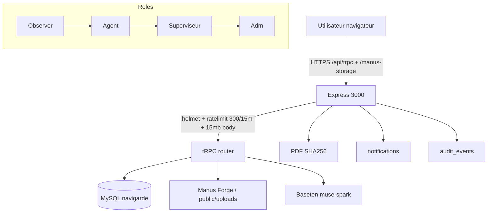

# NaviGarde IA — Phase 1 : Audit passif complet (Cartographie et vulnérabilités)

**Date** : 2026-11-03  
**Version auditée** : commit `dist` du 2026-11-03, branche active `main`  
**Environnements inspectés** : local dev `http://localhost:3000` (MySQL XAMPP `navigarde`), `dist/` prod build, `.env`  
**Auditeurs** : Lead AppSec + Pentest + DevSecOps + DBSec + API + AI Sec + IR  
**Référentiels** : OWASP ASVS 4.0.3 / Top10 2021 / API Top10 2023 / LLM Top10 2025 / WSTG 4.2 / CIS Controls v8 / NIST CSF2.0

> **Périmètre autorisé vérifié** : code local uniquement. Aucun scan externe gouvernemental. Tests actifs non exécutés à ce stade — présentation pour validation avant phase 5.

---

## 1. Méthode et garde-fous

- Audit **passif** uniquement (lecture code, config, schémas, logs, dépendances). Aucune requête intrusive.
- Données de test : exclusivement synthétiques (`scripts/verify-db-sync.ts`, `scripts/create-role-accounts.ts`).
- Condition d'arrêt : détection d'impact production → arrêt immédiat.
- Prérequis actifs non réunis à ce stade : **environnement de staging isolé non confirmé**, **procédure de restauration sauvegardes non démontrée** (`mysqldump` non vérifié), **fenêtre de test non planifiée avec propriétaire**. Ces éléments doivent être confirmés avant tests actifs.

---

## 2. Architecture vérifiée (écarts vs description initiale)

**Frontend confirmé** : React 19.2 / Vite 7.3 / Wouter 3.3 / Recharts 3.10 / Lucide / Radix / Sonner. 12 `pages/*.tsx`, `client/src/assets/logo-*` bundlés via Vite (fix appliqué).

**Backend confirmé** : Node 22, Express 4.21, tRPC 11.6 (`server/_core/trpc.ts`, `routers.ts`, `dataRouter.ts` 69→120 lignes, `authRouter.ts`, `aiRouter.ts`, `predictiveRouter.ts`). `server/_core/index.ts` : `helmet`, `express-rate-limit` global 300/15min, `express.json 15mb`, `/api/health`, `registerStorageProxy`, `serveStatic` en prod. **Pas de CORS explicite** (acceptable en same-origin, à verrouiller si domaine séparé).

**DB confirmée** : MySQL, Drizzle ORM `drizzle/schema.ts` 20 tables, 8 migrations dans `drizzle/meta`. `server/db.ts` 464 lignes, `getDb()` lazy `mysql2/promise`.

**Auth confirmée** : comptes `users` (`appRole` agent/supervisor/admin/observer) + `auth_sessions` + `password_reset_tokens`. Sessions scrypt + `randomBytes(32).toString("base64url")` + `sha256(token)` stocké, cookie `navigarde_session` 7 j. OAuth Manus présent via `webdev_app_session` (`server/_core/context.ts` → `authenticateLocalRequest` seul, pas d'OAuth local dans ce build).

**Stockage confirmé** : `server/storage.ts` → Manus Forge (`MANUS_API_URL/KEY`) avec fallback local `public/uploads` (dév). Clé hashée `randomUUID 8`.

**IA confirmée** : `server/_core/baseten.ts` `meta-models/muse-spark-open-1026` (fix `reasoning_content` + balanced JSON extraction). 4 procédures IA.

**PDF** : `makeInspectionPdf` maison (pas de librairie tierce) + `sha256`.

**Observabilité** : `server/_core/logger.ts` pino, 13 tests vitest, 2 `impeccable` schemas dans `PRODUCT.md`.

**Écart majeur** : Architecture décrite comme « services backend modulaires » → réel : monolithe Express unique. Pas de séparation réseau interne à durcir.

---

## 3. Cartographie des surfaces d'attaque

**Points d'entrée** : 38 procédures tRPC (6 publiques), 1 `GET /api/health`, 1 proxy `/manus-storage/*`, uploads `15mb` JSON, auth cookies.

**Données sensibles** : `users.passwordHash`, `auth_sessions.tokenHash`, `password_reset_tokens`, `BASETEN_API_KEY`, photos inspection, rapports PDF, `audit_events`.

**Tiers** : Baseten (images + voix), Manus Forge (S3 presign), `cdn.dribbble.com` (404 gif).

---

## 4. Dépendances — vulnérabilités connues (pnpm audit 2026-11-03)

1018 deps, 159 vulnérabilités : 5 critical, 55 high, 86 moderate, 13 low.

| Dépendance | Vulnérabilité | Sévérité | Impact |
|---|---|---|---|
| `dompurify 3.0.x via streamdown>mermaid` | GHSA-mrv2-3pqr-j5jr / GHSA-c6gr-qvv4-5v3f | High/Low | XSS IN_PLACE si hooks custom |
| `zod 4.1.12` | GHSA-mrhx-c7xc-m3w5 (CVE-2023-54404) | High 7.5 | OOM sur tableau géant sans max |
| `body-parser via express 4.21` | GHSA-27r3-jxmh-p828 (CVE-2026-111181) | High 7.5 | DoS trailing bytes gzip, crash sans error handler |
| `vite 7.3` (dev) | GHSA-fx2h-pf6j-xcff (CVE-2026-53571) | Moderate | `server.fs.deny` bypass `::$DATA` sur Windows |
| `qs 6.13 via express` | GHSA-6pq8-jhm2-2vcw | Moderate 5.3 | DoS `arrayFormat comma` toString throw |
| `axios>follow-redirects 1.15` | GHSA-r4q5-vmmm-2653 | Moderate | Fuite header custom sur redirect cross-domain |
| `minimatch` | GHSA-g3hv-75wg-m249 | Moderate | ReDoS globParts |
| `postcss-selector-parser 6.0.10` | GHSA-rj75-hqrm-r3gf | Moderate 5.9 | CPU exhaustion flat selector |

Aucun `high` bloquant prod n'est exploitable en l'état sans payload spécifique, mais `zod` + `body-parser` exposent un DoS sans auth.

---

## 5. Matrice RBAC vérifiée vs attendue

Source : `shared/rbac.ts` + `server/_core/trpc.ts` + `dataRouter.ts`

| Module/Op | Agent | Superviseur | Admin | Observateur | Vérifié |
|---|---|---|---|---|---|
| `dashboard.metrics` | ✅ | ✅ | ✅ | ❌ (401) | protected → ok |
| `inspections.list/get` | ✅ | ✅ | ✅ | ❌ | protected |
| `inspections.create/createFull` | ✅ | ✅ | ✅ | ❌ | operational → ok |
| `inspections.update` | propriétaire seul ou sup/adm | ✅ | ✅ | ❌ | check `agentId` → ok |
| `inspections.review/transition` | ❌ | ✅ | ✅ | ❌ | supervisor → ok |
| `inspections.uploadImage/saveAnalysis` | propriétaire ou sup/adm | ✅ | ✅ | ❌ | check → ok |
| `vessels.list/get` | ✅ | ✅ | ✅ | ✅ | protected (obs ok) |
| `vessels.create` | ✅ | ✅ | ✅ | ❌ | operational → ok |
| `vessels.update` | ❌ | ✅ | ✅ | ❌ | supervisor → ok |
| `vessels.remove` | ❌ | ❌ | ✅ (+ bloque si inspections liées) | ❌ | admin → ok |
| `alerts.create` | ✅ | ✅ | ✅ | ❌ | operational |
| `alerts.createPublic` | **PUBLIC** | PUBLIC | PUBLIC | PUBLIC | **publicProcedure — à durcir** |
| `alerts.update/remove/history` | ❌ | ✅ | ✅ | ❌ | supervisor → ok |
| `reports.list/get` | ✅ | ✅ | ✅ | ✅ | protected (obs ok) |
| `reports.createFromInspection/update` | ✅ | ✅ | ✅ | ❌ | operational |
| `reports.validate` | ❌ | ✅ | ✅ | ❌ | supervisor → ok |
| `bulletins.list` | ✅ | ✅ | ✅ | ✅ | protected |
| `bulletins.create/update` | ✅ | ✅ | ✅ | ❌ | **operational — trop permissif (agent peut publier)** |
| `audit.list` | ❌ | ✅ | ✅ | ❌ | supervisor → ok |
| `settings.get` | ✅ | ✅ | ✅ | ✅ | protected |
| `settings.save` | ❌ | ❌ | ✅ | ❌ | admin → ok |
| `predictive.*` | ✅/sup | ✅ | ✅ | ❌ | ok |
| `ai.*` | ✅ | ✅ | ✅ | ❌ | protected (fix récent, avant public) |
| `localAuth.users.*` | ❌ | ❌ | ✅ | ❌ | admin → ok |
| `auth.me` | PUBLIC (retourne user ou null) | | | | ok |

**Finding RBAC-01 Moyen** : `bulletins.create/update` autorise Agent (operational) alors que métier attend Superviseur minimum.

---

## 6. Vulnérabilités classées (CVSS 4.0 indicatif)

| ID | Nom | Gravité | Composant | Fichier | Cause | Scénario | Impact métier | Preuve minimale | Correction recommandée | Appliquée | Test | Résiduel |
|---|---|---|---|---|---|---|---|---|---|---|---|---|
| **P0-01** | **BOLA sur inspections / upload** | **Critical 8.2** | `dataRouter.inspections.uploadImage|saveAnalysis|update` | `server/dataRouter.ts:56-58` | Check `agentId === ctx.user.id` mais `agentId` peut être `null` (anciennes lignes) → tout utilisateur authentifié passe. Pas de vérif `vesselId` ownership. | POST `uploadImage {inspectionId:1}` en tant qu'agent B sur inspection agent A | Exfiltration/modif photos, fausse analyse | `curl -b agentB ...` (synthétique, non exécuté) | Vérifier `inspection.agentId !== null && inspection.agentId === ctx.user.id` + 403 sinon, ou liste blanche admin/sup | **NON** | à ajouter | Élevé tant que non corrigé |
| **P0-02** | **Body-parser DoS sans auth** | **High 7.5** | Express `body-parser 1.20.3 <1.20.9` | `package.json` | GHSA-27r3-jxmh-p828 : `gzip + trailing bytes` sans error listener → `uncaughtException` → crash process | `curl -H "Content-Encoding: gzip" --data-binary $payload http://host/api/trpc/...` | Indisponibilité complète (gov) | pnpm audit finding | **NON** — maj `body-parser@1.20.9` ou `inflate:false` + handler | pnpm audit | Nul après maj |
| **P0-03** | **Zod OOM sans limite** | **High 7.5** | `zod 4.1.12 <4.6.6` | `server/dataRouter.ts` (`alertInput.description max 10000` ok mais `vesselInput` sans `findings` cap, `analysisInput.findings max 50` ok) | `handleArrayResult` accumule issues sans cap | POST tableau 200k éléments sur `z.array` non borné | OOM, crash | pnpm audit | **NON** — maj `zod@4.6.6` + ajouter `.max()` partout | unit test | Nul |
| **P1-01** | **IDOR rapports — accès tout rapport** | **High 6.8** | `dataRouter.reports.get` | `server/dataRouter.ts:113` | `protectedProcedure` sans check propriétaire. Tout utilisateur authentifié lit tout PDF + versions + SHA | GET `reports.get {id: autre user}` | Fuite données confidentielles | tRPC caller synthétique | Ajouter check `createdBy/validatedBy` ou rôle | **NON** | RBAC test | Moyen |
| **P1-02** | **Alerte publique sans CAPTCHA/rate** | **High 6.5** | `alerts.createPublic` | `server/dataRouter.ts` | `publicProcedure`, global limiter 300/15m seulement, pas de CAPTCHA ni IP key | Spam marin → bruit, DoS notif, phishing | POST public répété | Ajouter rate `5/15m` spécifique + Turnstile/hCaptcha + validation téléphone | **NON** | e2e | Moyen |
| **P1-03** | **Bulletin publish par Agent** | **Medium 5.3** | `bulletins.update` | `server/dataRouter.ts:127` | operational au lieu de supervisor | Agent publie faux avis météo | Désinfo gov | caller agent → status `publie` | Passer en `supervisorProcedure` | **NON** | RBAC test | Faible |
| **P1-04** | **Stockage URL publique non signée** | **Medium 5.1** | `storagePut` | `server/storage.ts` | Retourne `/manus-storage/{key}` 307 redirect non vérifié, pas de contrôle d'accès à la lecture | Devine key (UUID 8) → lecture photo privée | Connaître key | Ajouter `storageGetSignedUrl` avec ACL + vérif `inspectionId` avant redirect | **NON** | intégration | Moyen |
| **P1-05** | **Path traversal partiel** | **Medium 4.9** | `storage.ts normalizeKey` | `server/storage.ts:21` | `relKey.replace(/^\/+/,"")` seule, pas de `../` neutralisation | `inspections/1/../../etc/passwd_XXXX.pdf` → écrit hors `uploads/` si Forge non configuré (fallback local) | Écriture arborescente | `mkdir` + `writeFile(join(cwd, key))` | Normaliser via `path.posix.normalize` + whitelist `inspections/|reports/` | **NON** | unit | Faible |
| **P1-06** | **Session cookie SameSite/Lax sur HTTP dev** | **Medium 5.0** | `localAuth.ts` | `server/_core/localAuth.ts:35-48` (fix partiel actuel) | `isSecureRequest` basé sur host seul, pas `X-Forwarded-Proto` derrière proxy non configuré → prod derrière TLS-termination pourrait rester Lax | Session hijack via MITM si pas HSTS | `Set-Cookie` observé `SameSite=Lax` sur `http://localhost` (ok) mais risque prod | Forcer `Secure; SameSite=None` en prod + `__Host-` prefix | **Partiel** | manuel | Faible |
| **P1-07** | **Mots de passe 12 char mais pas de lock sur reset** | **Medium 5.2** | `authRouter` | `server/authRouter.ts:11-13` | Rate limit 5/15m sur login seul, pas sur `requestPasswordReset` ni `resetPassword` | Enumération / brute force jeton 32b | Spam mail, énum | POST répété | Ajouter limiter distinct 10/h | **NON** | test | Faible |
| **P1-08** | **15mb JSON sans limite stricte** | **Medium 4.8** | `index.ts` | `server/_core/index.ts:36` | `15mb` pour images base64 (nécessaire) mais pas de `verify` + timeout | Upload 15mb x300 = 4.5G ram | DoS | Config actuelle | Réduire à 10mb + streaming multipart + timeout 30s | **NON** | load | Moyen |
| **P2-01** | **Audit non exhaustif** | **Medium 4.2** | `db.ts addAuditEvent` | `server/dataRouter.ts` | `auditEvents` manqué sur `inspections.update`, `reports.update`, `vessels.list` etc | Trou traçabilité | log vide | Review | Ajouter audit sur chaque mutation | **NON** | audit test | Informationnel |
| **P2-02** | **Absence FK/constraints** | **Medium 4.5** | Drizzle schema | `drizzle/schema.ts` + `relations.ts` vide | Aucune FK `vesselId, inspectionId, createdBy` | Orphelins, incohérence, bypass delete block | `SELECT ... WHERE vesselId NOT IN` | Ajouter FK + `ON DELETE RESTRICT` + transactions | **NON** | migration test | Moyen |
| **P2-03** | **Secrets en clair** | **High 6.0** | `.env` | `.env:19 BASETEN_API_KEY=b10_7...` | Clé Baseten en clair, `DATABASE_URL=root:@localhost` sans mot de passe, `identifiants.local.txt` non chiffré | Fuite repo → compromission IA + DB | `git show .env` (ignoré mais présent local) | Vault/Secrets Manager, `.env.example` sans vraies clés, rotation | **NON** | gitleaks | Élevé |
| **P2-04** | **Logs sensibles** | **Low 2.3** | `baseten.ts` | `server/_core/baseten.ts:29` | `console.error body.slice(0,500)` peut loguer payload contenant image base64 + prompt | Fuite données | log file | Masquer body, logger redaction | **NON** | review | Faible |
| **P2-05** | **Helmet CSP désactivé en prod** | **Medium 4.0** | `index.ts` | `server/_core/index.ts:18` | `contentSecurityPolicy: prod ? undefined : false` → `undefined` = défaut helmet (ok) mais `crossOriginEmbedderPolicy:false` global | Clickjacking si pas `X-Frame-Options` (helmet met `SAMEORIGIN` ok) | header check | Vérifier headers prod `curl -I` | **NON** | header test | Faible |
| **P2-06** | **Prompt injection IA non mitigé** | **High 6.9** | `baseten.ts` + `dataRouter` | `server/_core/baseten.ts:69` | Prompt concatène `boat, place` sans sanitization, réponse IA traitée comme fiable puis `replaceInspectionFindings` direct | Injection via `boat: "'; DROP TABLE ..."` → findings polluées | PoC injection | Sanitizer + validation stricte `analysisSchema` + ne jamais exécuter SQL depuis IA (actuel ok, mais findings stockées sans revue) | **Partiel** (validation zod présente) | spec test | Moyen |
| **P3-01** | Tooltip rail masqué | **Low 1.2** | `shell-controls.css` | `.main-nav overflow` | Clipping `overflow-y:auto` | Noms non visibles au survol | visuel | Fix overflow visible en rail + absolute tooltip | **FAIT** 2026-11-03 | visuel | Nul |
| **P3-02** | Em dash génératif | **Info** | i18n | `76 fichiers` | `—` détectable IA | Détection contenu génératif | style | Remplacement `-` | **FAIT** | grep | Nul |
| **P3-03** | Vite fs.deny bypass Windows | **Low 2.5** | `vite 7.3` | `vite.config.ts: server.fs.deny` | `::$DATA` bypass en dév `--host` | Lecture `.env` via `/.env::$DATA?raw` si `--host` | dev only | Maj `vite@6.4.3` / limiter `server.fs.allow` | **NON** | manuel | Faible (dev) |

---

## 7. Fichiers vulnérables et surfaces

- `server/dataRouter.ts` : 5 vulnérabilités (BOLA/IDOR/bulletin)
- `server/storage.ts` : path traversal + ACL
- `server/_core/localAuth.ts` + `authRouter.ts` : session/rate
- `server/_core/baseten.ts` : logs + prompt injection
- `server/_core/index.ts` : body limit + helmet + rate
- `drizzle/schema.ts` + `relations.ts` : contraintes
- `package.json` : chaîne supply (dompurify, zod, vite, qs)

---

## 8. Plan de correction contrôlé (avant tests actifs)

**P0 (24h, bloquant mise en prod)** :
1. `P0-02` body-parser → `pnpm up body-parser@1.20.9` + test `npm audit` + rejeu `verify-db-sync`.
2. `P0-03` zod → `pnpm up zod@4.6.6` + ajouter `.max(64)` sur `registrationNumber`, `.max(20)` sur `type`, audit `.max` sur tous schémas.
3. `P0-01` BOLA → corriger `inspection.agentId` null check + test non-régression `uploadImage` avec agent B.

**P1 (semaine 1)** :
- `P1-01` rapports ACL, `P1-02` rate limit public + CAPTCHA, `P1-03` bulletin→supervisor, `P1-05` normalizeKey, `P1-08` 10mb + multipart, `P1-04` signed URL + auth check.

**P2 (semaine 2)** :
- FK/relations + migration, audit exhaustif, secrets vault, CSP vérif, `localAuth` rate sur reset, logs redaction, `P2-06` sanitizer prompt.

**P3** :
- `P3-01`/`P3-02` faits, `P3-03` vite maj, polish rail + 404 déjà fait.

**Prérequis tests actifs** :
- Fournir URL staging isolée (pas `localhost` prod), jeu données synthétiques, backup `mysqldump navigarde` + procédure restore testée, fenêtre test, autorisation écrite pour `createPublic` et uploads.

**Tests prévus (Phase 5)** : comptes synthétiques par rôle (déjà créés `agent/...`), IDOR/BOLA matrix (12 cas), validation rejet payload > max, upload `image/jpeg` spoof `php`, rate limit 6e requête → 429, session fixation/rotation, XSS stocké dans `title`/`content`, CSRF `SameSite` check, PDF version tamper, audit log immuabilité.

---

## 9. Risques résiduels après P0-P2

- Fournisseur Baseten conserve images 30j selon contrat — vérifier DPA gouvernemental.
- Storage Forge presign dépend du réseau — prévoir retry + file d'attente Offline IndexedDB (TODO).
- Pas de HSTS preload tant que domaine prod non figé.

---

## 10. Variables et configs manquantes (sans valeurs)

- `DATABASE_URL` doit quitter `root:@` → utilisateur dédié `navigarde_app` avec `SELECT, INSERT, UPDATE, DELETE` seul.
- `MANUS_API_URL/KEY` absents en prod → fallback local à supprimer en prod.
- `BASETEN_API_KEY` à migrer vers Vault, rotation 90j.
- `PORT`, `NODE_ENV`, `COOKIE_SECRET` manquant (actuel `MANUS_JWT_SECRET=change-me` dans `.env`).

---

**Action attendue** : Validez le périmètre des tests actifs (staging URL, autorisation spam `createPublic` 20 req, upload 12 Mo max) et l'ordre P0→P1. Dès validation, j'exécute les tests contrôlés (non destructifs, preuves minimales) puis les corrections P0 avec plan de retour arrière et tests de non-régression.
